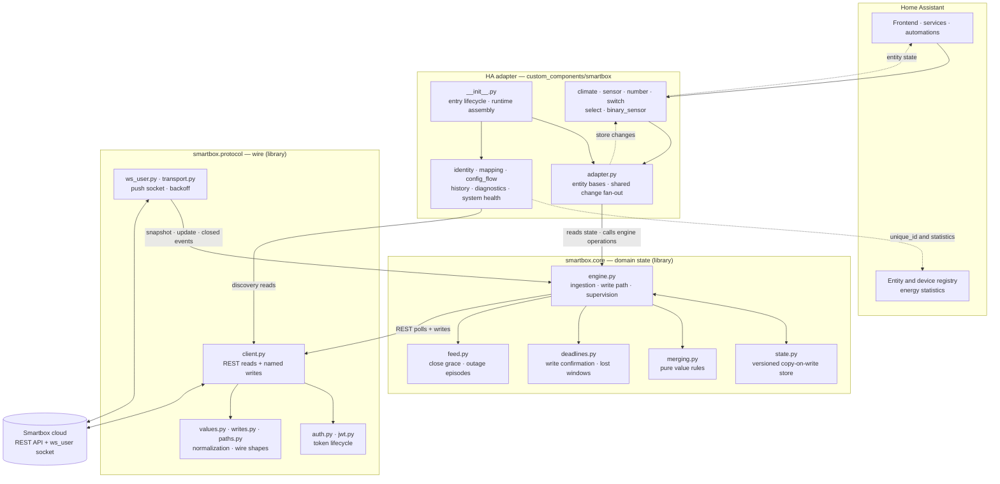

# Architecture

How the integration is put together, and why it is shaped this way. It is written for a reader who knows Home Assistant but not Smartbox, and for one who knows the vendor's cloud but not this codebase. Companion documents: [README.md](../README.md) for user-facing behavior, [CONTRIBUTING.md](../CONTRIBUTING.md) for the workflow and the wire-fact discipline, and [api-contract.md](api-contract.md) for the wire record itself.

## What it is

A Home Assistant custom integration (domain `smartbox`) for Smartbox electric heaters. It talks to the vendor's cloud directly: REST calls for reads and writes, plus one `ws_user` websocket per account for pushed updates. A "box" (the site gateway) carries several heater nodes; both become Home Assistant devices.

Since `3.1.0-rc.1` the wire and domain layers are the separate `smartbox` library (`smartbox.protocol` and `smartbox.core`). `manifest.json` requires `smartbox>=3.2.1,<3.3` (published on PyPI), so Home Assistant installs it with the integration. The 3.0.0 release vendored the same layers; the split is the 3.1 line.

## The three layers

The split keeps two kinds of churn apart: the vendor's cloud (endpoints, frame shapes, timing quirks) and Home Assistant (entity model, lifecycle, APIs). Wire knowledge lives in one package, Home Assistant knowledge lives in one package, and the state between them is plain Python, testable without either. The import directions are enforced by the library's layering test (an import scan over `smartbox.protocol` and `smartbox.core`), so the rule is checked, not aspirational.

The shape, in one picture (imports point downward; pushed frames and store changes travel upward):



### `smartbox.protocol` — everything that knows the wire

The only layer that touches the network:

- `auth.py`, `jwt.py` — the token lifecycle: one grant per password, refresh rotation, serialized token calls. The integration persists the granted bundle in `.storage` and restores it at setup; the library's `on_grant` seam rewrites it after every grant.
- `client.py` — the REST client: reads, plus the named write operations from `writes.py`, addressed via `paths.py`.
- `transport.py`, `ws_user.py` — the transport seam and the `ws_user` socket: a fresh token per connect, escalating backoff, a connect watchdog, bounded teardown.
- `values.py` — wire normalization: units, quantization, the schedule shape; one owner per rule.
- `reseller.py`, `retry.py`, `timing.py`, `errors.py`, `events.py` — the brand table, the backoff helper, the timing seam every wait and clock read goes through, the error hierarchy, and the typed events the transport emits.

Wire rules are recorded with provenance in `docs/api-contract.md`. Code comments cite the record instead of restating a rule as folklore, and new findings are verified with `tools/live_probe.py` before they are believed.

### `smartbox.core` — the domain, without Home Assistant

The state of the home, independent of the HA entity model:

- `state.py` — the versioned, copy-on-write store: the single source of truth.
- `merging.py` — the pure value/extraction rules the merges apply.
- `engine.py` — ingestion (with exact-equality dedup), the write path (optimistic merge, per-node serialization, per-slot confirmation), and supervision.
- `deadlines.py` — write-confirmation and lost-window bookkeeping, served by one timer.
- `feed.py` — the feed monitor: close grace and outage episodes.

It imports the protocol for event types, errors, value comparison and the timing seam — nothing else from the integration — and never imports Home Assistant.

### the HA adapter — the only layer that imports Home Assistant

`custom_components/smartbox/*.py`: runtime assembly and the entry lifecycle (`__init__.py`), the shared entity bases and accessors over engine state (`adapter.py`), the six entity platforms, the domain services (`services.py`), setup, reauth and reconfigure (`config_flow.py`), unit adaptation for the entities, the energy statistics import on first setup (`history.py`), diagnostics and system health.

It renders store state into entities and translates entity and service actions into engine operations. It holds no wire knowledge of its own.

Component-level setup (`async_setup`) also serves the optional bundled programme card: it registers `frontend/` as a static path and loads `smartbox-program-card.js` as an extra frontend module when the asset is present. The card reads the schedule sensor's attributes and calls `smartbox.set_schedule`; that entity/service contract is its only coupling to the Python side.

Entity creation uses the discovery identity: `identity.py` freezes the REST node PID/version/setup and the platform builders decide which entities exist from that snapshot. Runtime properties use the live version and setup slots, so a late version frame updates bounds, storage modes and the schedule catalogue. A PID first seen in such a frame does not add or remove entities until the entry reloads; the `NodeAdded` membership path already requests a reload when the node set changes.

## Repository map

```
custom_components/smartbox/   the integration
# smartbox.protocol and smartbox.core live in the separate smartbox library.
├── __init__.py               entry lifecycle, runtime assembly
├── adapter.py                entity bases and accessors over engine state
├── devices.py                box device registry entries and node links
├── services.py               domain service registration, schemas and handlers
├── entity_builder.py         per-platform builders for new membership
├── membership.py             NodeAdded → identity refresh / reload hint
├── exceptions.py             translated user-facing error constructors
├── compat.py                 probatio/voluptuous selection for the HA range
├── identity.py               discovery results; capability gates
├── product.py                product labels from the version PID
├── control_mode.py           vendor-app control-mode catalogue and gates
├── mapping.py                schedule/RTC/boost decoding
├── config_flow.py            setup, reauth and reconfigure
├── climate.py, sensor.py, number.py, switch.py,
│   select.py, binary_sensor.py   the six entity platforms
├── frontend/                 the bundled programme card (no build step)
├── history.py                the energy statistics import
├── diagnostics.py, system_health.py
├── const.py                  domain constants, node types, defaults
├── reseller.py               entry data → reseller identity
├── token_store.py            per-entry token bundle in .storage
├── manifest.json, icons.json, brand/, services.yaml,
│   strings.json, translations/

tests/                        the flat suite; its scaffolding lives beside it
├── conftest.py               fixtures: the mock world via the client seams,
│                             C/F runs where the node scale matters
├── const.py, mocks.py        the mock world's data; entity-id formulas
├── test_utils.py             expected-value helpers (rounding, conversion)
├── stack.py                  seed_stack plus frame/push/confirm helpers
├── fakes.py, fake_api.py, fake_transport.py
│                             the fake server and transport
├── fixtures/live/            captures from the real cloud
└── test_*.py                 the tiers tabled below

tools/live_probe.py           CLI for probing the real cloud
docs/                         the wire records (see "Keeping the record honest");
                              status.md is the curated live state
.github/workflows/            CI: tests, lint, type checks, HACS, hassfest
pyproject.toml, uv.lock       metadata and the locked development environment
hacs.json, codecov.yml        packaging and coverage configuration
```

## How it works

### The read path

1. Entry setup probes authentication and `ws_user` support, reads device and node identity over REST, and builds the store.
2. The socket delivers an initial snapshot and, after that, update frames; REST reads serve what the snapshot does not carry, and three timers poll what the wire never pushes: total consumption, PMO power and the RTC clock drift.
3. Every frame is merged into the store by the pure merge rules. A frame for a device or node the snapshot does not hold is dropped: nothing about the account is invented from a frame.
4. A snapshot or `/mgr/nodes` update that adds a node emits `NodeAdded`. The adapter refreshes the REST identity and calls the platform builders, which add the new device and node entities in place. If the refresh still fails after a short retry window, one repair issue per entry names the pending nodes and asks for a reload. A node that disappears leaves its entities in place and unavailable, so a backend glitch cannot remove history or unique ids.
5. A fully parsed list that no longer holds a node emits `NodeRemoved`; a box missing from a non-empty snapshot emits `DeviceRemoved` (and `NodeRemoved` for its nodes). The membership watcher records a candidate, waits out a grace window, and re-reads the full account membership. Only a second confirmed absence removes the device through the device registry; a failed or malformed read keeps the candidate, and the member reappearing cancels it. When REST contradicts the shrink, the node list is replayed into the engine so the node's shell and frames recover. The device registry keeps deleted entries, so a re-paired heater restores the same device and entity ids, area and history. A device the integration cannot confirm stays user-removable through `async_remove_config_entry_device`.
6. Store changes fan out to the entities, which render straight from the store. The three REST-polled sensors (PMO power, total consumption and the box RTC drift) keep their last read locally because the wire never pushes those values; every pushed value renders from the store.

Availability moves on evidence: a lost marker opens an unavailable window, an ok frame clears it, and a socket close opens a grace window that a fresh frame clears silently — only an expiring one becomes a reported outage.

### The write path

1. Entities and services call named engine operations; these are the only write entry points.
2. An operation posts over REST. The engine merges the posted body over the store optimistically and serializes writes per node, because a setup or programme POST carries the whole object and two in flight would overwrite each other's keys.
3. Confirmation is armed just before the POST so a frame already in flight is caught; the 6 s countdown starts when the POST returns (a token refresh or slow request cannot expire it mid-flight). The confirming frame retires the window. A window that expires runs one GET of the written slot after a short settle: lost-marked data flips the node unavailable, data reconciles the store, and an API failure is no evidence. A write that changes nothing arms nothing, because the wire pushes no frame for a value-equal write.

## Invariants worth knowing before touching anything

- The wire record is `docs/api-contract.md`. New wire facts are probed, recorded, and only then encoded; comments cite the section. "It works" is not the acceptance bar — the record is.
- The store is the single source of truth for pushed state; entities hold no cache of it. The three REST-polled sensors hold only their own last read.
- Frames never create state, and an empty body is not evidence: a slot frame for an unknown device or node is dropped. Membership is the exception: the node list (`/mgr/nodes` and the snapshot) is authoritative for installed nodes; an entry with `installed: false` is an empty slot and adds no node shell. The adapter materializes an addition through a REST refresh and the platform builders, and confirms a removal against a fresh full account read before it cleans the device registry; a failed read removes nothing. A failed refresh falls back to a repair issue.
- Availability only moves on evidence — lost markers, ok frames, the close grace — so a stale value cannot keep rendering as available.
- Writes are serialized per node, applied optimistically, and confirmed per slot; each confirmation is generation-owned, so overlapping writes do not disarm each other.
- Time is a seam: every sleep and monotonic clock read goes through `smartbox.protocol.timing`, which is how tests exercise timeout logic without waiting. `asyncio` deadlines stay on `loop.time()` (asyncio compares against its own clock), and wall-clock reads that must match the wire (JWT `exp`, sample epochs) use `time.time()` deliberately.
- Teardown is total: unloading an entry clears its deadlines, timers and listeners; only the per-entry token record in `.storage` deliberately survives a reload (it is removed on entry removal or a credential change).
- Layers import downward only — adapter → core → protocol — and the protocol layer stays free of Home Assistant and of the other layers.
- Module docstrings are the contract for their module — the engine's ordering rules, the named writes' wire rules, the feed's liveness rules; read them before changing behaviour there.
- Entity identities are stable: `translation_key` mirrors the per-entity key and `unique_id` is `<node_id>_<key>` (or `<dev_id>_<key>` for box entities); changing a formula costs users their history.
- Device hierarchy mirrors the account: every node device carries the registry link to its box (`devices.node_link`, using `via_device_id` on HA 2026.8+ and the identifier-based `via_device` on the 2026.5 floor), so the box page lists its heaters under "Connected devices" and each heater page shows "Connected via". Setup registers the box entry before the platforms, and the membership refresh does the same for a box discovered later, so the link resolves when the node entity is added.
- Numbers carry the device's own C/F scale bounds (`_DeviceScaleBounds`); the away offset is a delta and deliberately has no temperature device class (HA would convert a classed number as an absolute temperature).
- Shipped text may reference the repo's own history (versions, earlier commits) where that helps the reader; it cites the durable docs and never points at agent instructions or files that do not ship in the repo.
- User-facing strings are ICU messages in the Home Assistant frontend: braces are placeholders there, so a stray brace renders as a translation error. A gate keeps the translation files and `services.yaml` free of stray braces.

## Tests, and what each tier is for

| Tier | Files | What it holds |
| --- | --- | --- |
| Wire units | `test_client`, `test_auth`, `test_writes`, `test_values`, `test_mapping`, `test_ws_user_transport` | The wire rules: request shapes, body forms, normalization, the token lifecycle. Expected values trace to the contract record. |
| Domain units | `test_core_engine`, `test_core_availability`, `test_core_writes`, `test_core_state` | Store merging and engine behavior, exercised with no Home Assistant involved. |
| Platform behavior | `test_climate`, `test_sensor`, `test_number`, `test_switch`, `test_select`, `test_binary_sensor`, `test_init`, `test_availability`, `test_config_flow`, `test_diagnostics`, `test_system_health`, `test_identity`, `test_adapter`, `test_ws_user_wiring` | Real service calls and entity states. Only the wire endpoints are fakes; the engine, store and adapter under them are the real code. |
| Device matrix | `test_product_code_parity`, `test_entity_surface_matrix`, `test_controller`, `test_storage` | Every decoded product code's family, bounds (climate, programme, max-limit, boost), profiles, boost-parameter policy, duty presets and capability/firmware gates, plus the exact entity domains/unique keys per representative family and variant, including the box-level entities. |
| Wire reality | `test_loopback` | The real client against a real local aiohttp server: pins what the transport fakes assume about handshakes, closes and timeout shapes. |
| Chaos | `test_soak` | The whole stack against a hostile local server — kills, stalls, 5xx, lost frames — asserting structural invariants: no stuck deadline, no leaked timer, silent teardown. |
| Gates and tooling | `test_layering`, `test_docs_references`, `test_translations`, `test_version`, `test_utils`, `test_lib_contract`, `test_payload_bounding`, `test_live_probe`, `test_fake_api`, `test_fake_transport` | Architecture, documentation and tooling rules, and the fakes' own behavior. |

One caveat matters more than the rest: the mock world is a regression baseline, not a wire oracle. It encodes the account as the contract records it, and it cannot tell us that the record is wrong. When behavior and the record disagree, the record wins until a probe says otherwise — that is what `tools/live_probe.py` and the captures under `tests/fixtures/live/` are for.

## Working in the repo

Setup and the three gates — [CONTRIBUTING.md](../CONTRIBUTING.md) has the rest:

```
uv sync --all-extras --dev
.venv/bin/python -m pytest -q      # all cores; -n0 for a single test
.venv/bin/ruff check custom_components tests tools
.venv/bin/mypy custom_components tools
```

**Probing the real cloud.** `tools/live_probe.py` drives the real hosts for wire investigation (`auth`, `probe`, `reads`, `ws`, `write`, `all`). It reads the user's own gitignored `.env` at the repo root — nothing here prints or commits that file — and the write commands refuse to run without an explicit acknowledgement flag, because they move real heaters.

**Where a change goes.**

- New entity or attribute: put the state in the core (merge rules), expose it through an adapter accessor, render it in the platform entity, and test it in the matching tier.
- New write: a named operation in `smartbox.protocol.writes`, its slot and path in the engine, the entity or service surface, and a test pinning the POST body.
- New wire field: probe it, record it in `docs/api-contract.md`, normalize it in `values.py` or `merging.py`, then surface it upward.

The lower half of the stack never needs Home Assistant to be testable.

## Keeping the record honest

Three documents, three roles: `docs/api-contract.md` settles wire acceptance — probed facts with provenance tags, open questions, recorded divergences — `docs/webapi-spec.md` holds the decoded web app's statics, and `docs/api-ws-user.md` holds the current vendor apps' behavior plus a parity checklist to re-run per vendor app release. Where an app-derived document and a live observation disagree, the live observation wins, and the disagreement is recorded rather than silently resolved. [CONTRIBUTING.md](../CONTRIBUTING.md) describes the discipline in full; the gates here keep it enforced — every citation resolves against the in-repo copy, and shipped text stays free of process narrative.

## The `smartbox` library

`smartbox.protocol` and `smartbox.core` are the extracted library, pinned by `manifest.json` to a tagged tarball. The integration owns only the HA adapter, the entity model and the platform wiring. The reseller table and node-type values come from the library; `tests/test_lib_contract.py` keeps the integration side in step with it. The library is versioned independently and is also usable without Home Assistant.

### Device semantics (planned extraction)

Product/controller profiles (setpoint and programme ranges, control-mode
catalogues, lock/boost/storage/thermostat rules) still live in the adapter.
The target is a Home Assistant-free `smartbox.device` layer consumed by the
entities, the CLI and diagnostics, with the adapter keeping only presentation
and entity lifecycle. The design, migration slices and acceptance tests are in
[device-semantics.md](device-semantics.md). It is not scheduled.

## Where to go deeper

| Question | Document |
| --- | --- |
| What does the vendor cloud do, per endpoint and frame? | `docs/api-contract.md` |
| What do the current vendor apps do? | `docs/api-ws-user.md` |
| What did the vendor's web app code do? | `docs/webapi-spec.md` |
| How do I set up and contribute? | `CONTRIBUTING.md` |
| How is the integration used? | `README.md` |
| What is in flight right now? | `docs/status.md` |
| Where is the device-semantics extraction design? | `docs/device-semantics.md` |
| How do I verify a claim against the real cloud? | `tools/live_probe.py` |
| What changed in each release? | `CHANGELOG.md` |
